# Strings

**A marionette theatre for your hands.** Created by Abdul Musawar Soomro.

You pinch a little wooden control bar and Sir Pip, a knight on strings, walks, bows, waves and jumps. A robot puppeteer works everyone else, and together you put on a show: a nine-chapter fairy tale, a story you make up yourself, or just playing around.

**Play it:** [strings.musawar.tech](https://strings.musawar.tech) (open it in the Quest Browser for VR; it also runs in any desktop browser)


---

## What it looks like

| | |
|---|---|
| 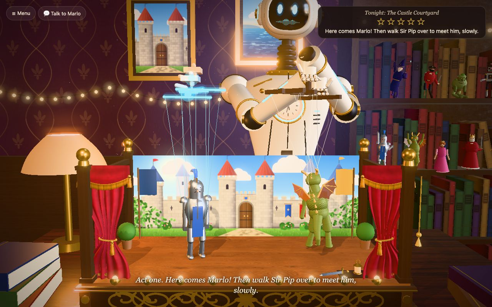 | 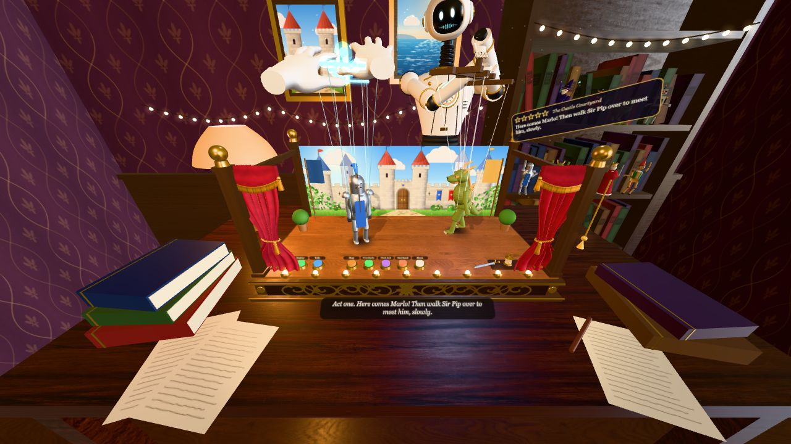 |
| The stage, played with a mouse | The same stage in VR, sitting in front of you |
| 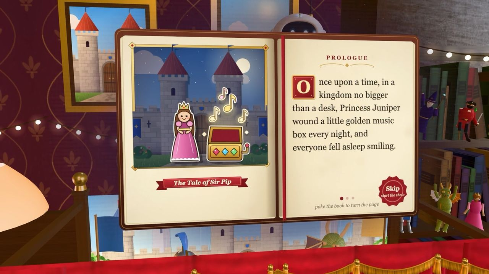 | 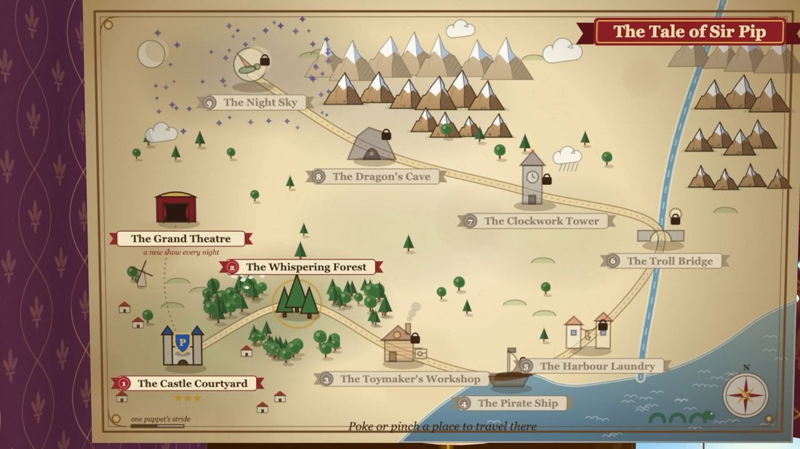 |
| Every chapter opens with a pop-up storybook | The map of the kingdom, one road, nine stops |
| 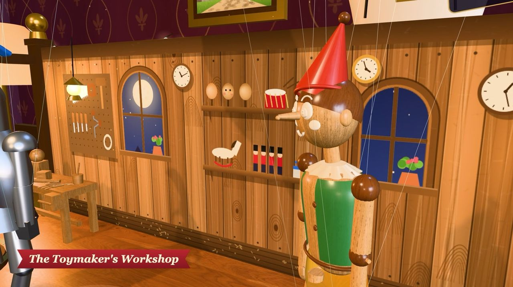 | 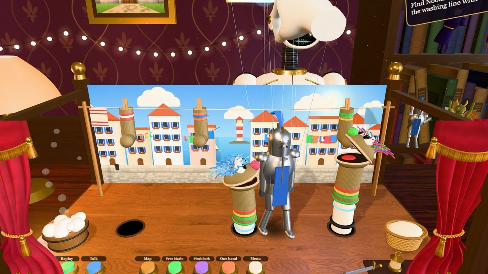 |
| Twig's nose grows when he fibs | The robot works Noodle from under the stage |
| 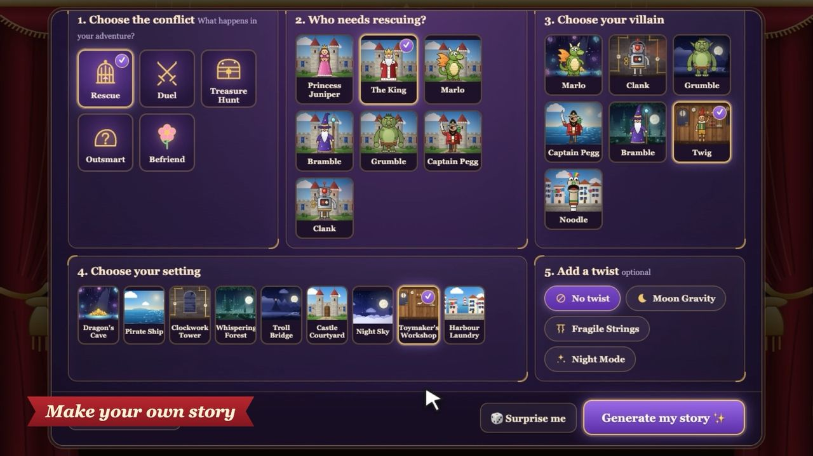 | 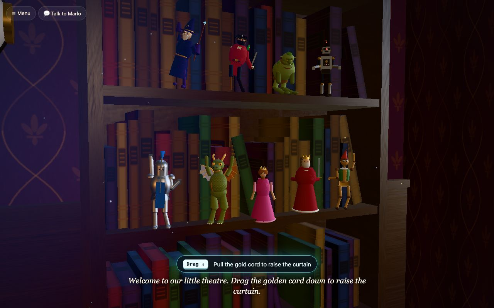 |
| Make your own story | The whole company, each in their own pose |
| 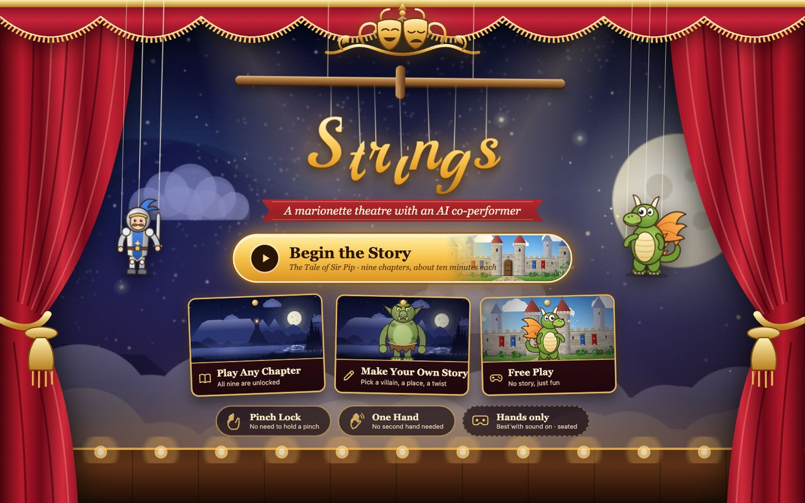 | 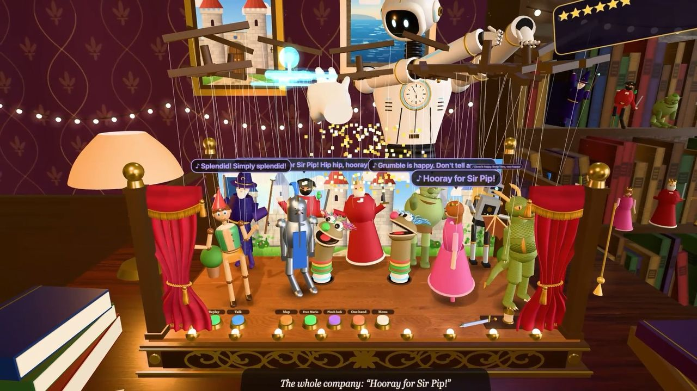 |
| The start menu: the title hangs on real strings | The curtain call, everyone on stage at once |

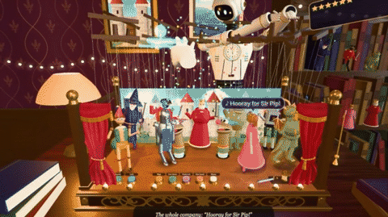

---

## The idea

Most VR games give you a controller and a gun. I wanted something you could do sitting at a desk, with nothing in your hands, that felt like a craft instead of a reflex. Marionettes were perfect for that. A real marionette is all about small wrist movements and patience, and when you get it right the puppet looks alive.

So the whole game is built around one feeling: you are holding the strings. You don't press a button to make Sir Pip bow. You tip your wrist, the strings pull, and he bows because of physics. If you let go, he falls in a heap, and Marlo the dragon falls over too, just to make you feel better about it.

---

## How I built it

### Custom physics engineering

There's no physics library in Strings. Every puppet is my own Verlet ragdoll: 16 particles joined by rigid sticks, with a soft waist so the body can bend. The strings are rope constraints that run back up to two control bars, one for the body and one for the arms. When you hold a bar, its strings go taut. When you let go, the strings pay out and the puppet slumps, the same way a real one does.

Getting a puppet to *walk* well was the hardest part. With pure physics he just slid around. So when the bar moves sideways I shorten the knee strings one after the other, which turns a slide into steps. A couple of other small helpers keep it playable without making it feel fake:

- On the desktop, the held bar has a soft floor a little below its rest height, so if you hold the mouse low he stays on his feet instead of folding up.
- Hand movement is amplified a little in the headset, so small wrist moves give big stage moves (good for seated play).
- Strings glow when they're taut and make a little pluck when they snap tight.
- In "Fragile strings" mode, yank too hard and a string actually snaps.

The physics runs every frame for every puppet on stage, and I kept it allocation-free so the garbage collector never causes a hitch in the headset.

### WebXR development

Strings runs in the browser with WebXR, so there's nothing to install. In the Quest Browser you use your real hands: the game reads all 25 joints of each hand, and a pinch is the gap between your thumb and index finger (with a bit of hysteresis so it doesn't flicker). You pinch the bars to hold them and poke buttons, the map and speech bubbles with your fingertip.

A few things I'm happy with:

- **VR first.** On a headset the gold "Begin" button goes straight into VR. "Play on this screen" is there if you'd rather stay flat.
- **Mixed reality.** In passthrough you look at your real desk and pinch to put the stage down on it. A WebXR anchor keeps it there, and the puppets can even step off the stage onto your desk.
- **The stage comes to you.** It's placed from your actual head position when you enter, low and close like a theatre on a desk. Pinch with both hands for a second and a half to bring it back in front of you.
- **The same code on the desktop.** Without a headset, a mouse and keyboard "hand simulator" produces the same hand pose and pinch as real hands, so all the grab logic is shared. I also wired in Meta's IWER emulator (`?emulate`) so I could test the real hand-tracking path without putting the headset on every five minutes.
- **Frame rate.** Puppets are GPU-skinned (each one's 60 or so moving parts become bones of a single mesh), static scenery is merged into a few draw calls, shadows update every other frame in the headset, and fixed foveated rendering is on. On the desktop the game watches its own frame rate and steps quality down if it needs to.

### Game design

The main mode is *The Tale of Sir Pip*: a princess has been taken by Clank, a lonely clockwork robot, and Sir Pip has to cross the whole kingdom to bring the music back. Each of the nine chapters has its own painted set, its own guest and its own game, and every one of them teaches a different way to use the strings:

| Chapter | Guest | What you do |
|---|---|---|
| The Castle Courtyard | Marlo the dragon | Learn to walk, bow and wave |
| The Whispering Forest | Old Bramble | Catch fireflies with a lantern, then copy his spell |
| The Toymaker's Workshop | Twig | Watch his nose and walk onto True or Fib |
| The Pirate Ship | Captain Pegg | A sword fight: duck high swings, jump low ones |
| The Harbour Laundry | Noodle the sock | Boop him as he pops up, then find his twin |
| The Troll Bridge | Grumble | Answer a riddle by standing on the right stone |
| The Clockwork Tower | Clank | Sneak past the searchlight, dodge his zaps |
| The Dragon's Cave | Marlo | Find the lost gems in the dark |
| The Night Sky | Everyone | Fly on Marlo's back and catch Clank |

The ending was important to me. You don't beat Clank. He's not wicked, he's lonely, and the bravest thing Sir Pip can do is bow to him. Then the King knights you, the whole company comes out for a curtain call and cheers at once, and if you clap, Marlo breaks his strings and flies out of the theatre to land in your open hand.

Around the story there's a lot to play with:

- **How you perform changes the ending.** Graceful play (bows, waves, gifts) earns a different finale from slapstick (falling over a lot) or drama. A critic reviews every show on a playbill you can collect.
- **Mistakes become theatre.** If you fail, your co-star turns it into a bit: a matching pratfall, a "ta-da, all part of the show!", and the audience laughs instead of groaning.
- **Make your own story.** Pick a problem, someone to rescue, a villain, a place and a twist, and the theatre stages it, fully voiced.
- **Free play.** Be any character on any stage, with any co-star.
- **Unlockable modes.** Moon gravity, fragile strings and a party mode, earned by collecting playbills.

### AI character development

I wanted the cast to feel like they're paying attention to you, and I wanted it to work offline, since the hosted game has no server. So each guest has a small "mind" of its own: a mood made of joy, trust and energy that shifts with what you do, a memory of how you've treated them, and some initiative. Marlo will challenge you to copy him, fetch you things, sulk if you ignore him and nap if you're slow.

Underneath, an action detector reads Sir Pip's body every frame (walk, bow, fall, jump, wave, turn, slump, rise, approach) and the mind picks a reaction. Rush at Marlo and he hides. Come back gently and he becomes your friend. The robot puppeteer then performs that reaction with his own arms on the guest's control bar, so what you see is one puppeteer working another puppet, not an animation playing.

Marlo also keeps "Backstage Notes" on you, which you can read after a show.

The headset browser has no speech recognition, so talking works by poking speech bubbles, and Marlo answers in his own voice and acts it out. If you run the optional local server, the lines can come from a live language model instead (Qwen 2.5 through Ollama, or a cloud model through Anthropic's API), which returns a line plus a reaction for the puppet to perform.

### Audio production

Every word in the game is a real recorded voice, never the browser's robotic speech, and all of it is pre-recorded so the hosted version works with no server. That's around 900 lines.

- **The narrator and most of the cast** use Kokoro, an open neural voice model, with a different voice and pace for each character.
- **The voices with feeling.** Marlo, Princess Juniper, the King, Noodle, Doodle, Bramble and Grumble are recorded with Qwen3-TTS. Instead of picking a voice from a list, you describe it ("a very old wizard, breathy and mysterious, with a soft chuckle") and give each line its own feeling ("thrilled and excited", "sleepy and drowsy, yawning"). I wrote a feeling for every one of their 184 lines.
- **Clank sounds like a machine.** His lines play through a robot filter I built in Web Audio: a ring modulator for the buzz, a short comb filter for the metal, and a brighter top end.
- **The curtain call** plays all eight cheers at once, each from where that character is standing, instead of one after another.
- **Spatial sound.** Voices come from the character speaking, and the robot's voice comes from his head.
- **Music and ambience** change with each chapter (CC0 music, forest birds, the sea, a dungeon drip), and the music ducks under speech.

### 3D content creation

I drew everything in code. There are no downloaded models: every puppet, prop, set and the room itself is built from three.js geometry and textures painted on canvases at load time.

- **The puppets** share one rig, and each character gets a procedural "skin": Sir Pip's armour, Marlo's scales and wings, Twig's real-grain wood, a robe for Bramble, socks for Noodle and Doodle.
- **The theatre.** The velvet curtains are two panels that really gather as they open, with a shader that makes the pile catch the light at grazing angles, gold bullion fringe and tassels. My first curtain looked fake, so I rebuilt it from scratch.
- **The sets** are painted backdrops in layers (sky, drifting clouds, foreground) with 3D pieces in front, and things that move: waves, lightning, turning gears, glowing crystals.
- **The storybook and the map** are drawn on canvases, with pop-up pages and a road that winds through the whole kingdom.
- **Lighting.** A warm key spot, a front fill like footlights, glowing brass footlights, fairy lights strung around the room, and soft contact shadows under every puppet so they stand on the stage instead of floating over it.
- **The showcase.** The whole company stands on the bookshelf behind the stage, each in their own pose (I pose them with their own strings, then freeze them).

### Accessibility engineering

I designed for one situation: someone sitting down, with just their hands, in a small space.

- **Seated, hands only.** Everything is reachable within about two feet, and you can pinch a bar from below so your arms can rest low.
- **One hand is enough.** "One Hand" mode makes the arm bar follow the body bar, so you can still wave by rolling your wrist.
- **Pinch Lock.** You don't have to hold a pinch: pinch once to pick up, once to put down. Good for tired hands.
- **Subtitles everywhere.** Every spoken line is captioned, on the page and in the headset (a strip under the stage), and the current goal and stars sit in a corner of your view.
- **Never stuck.** If you're unsure what to do, a glowing arrow points at what to use, a little animation shows the motion, and a label shows the key or gesture. Spells are written out on a card with the key for each move, and they replay if you missed them.
- **Forgiving.** Leftover wobble after a move doesn't count as a mistake, and you can play the whole thing on a laptop with a mouse if you don't have a headset.

---

## Install and run it yourself

You need [Node.js](https://nodejs.org) 22 or newer. That's it for the basic game.

```bash
git clone https://github.com/mazzyy/strings.git
cd strings
npm install
npm start
```

Then open [http://localhost:8080](http://localhost:8080). To use another port: `PORT=8095 npm start`.

**Useful address options**

| Add to the address | What it does |
|---|---|
| `?emulate` | Loads Meta's Quest 3 emulator, so you can try the VR version on a computer |
| `?autostart` | Skips the menu |
| `?quality=low` | Forces a quality level (`low`, `medium`, `high`) |
| `?voices=kokoro` | Plays the older voices instead of the Qwen ones |

**Desktop controls**

| Input | Does |
|---|---|
| Hold left click | Pinch the bar (G makes it sticky) |
| Move the mouse, scroll wheel | Move your hand, nearer or further |
| Q / E | Rock the wrist (he walks) |
| W / S | Tip forward or back (bow) |
| A / D | Twist (turn) |
| Space | Flick up (jump) |
| Shift + mouse | Your other hand, on the arm bar (wave) |
| Click a prop | Hand it to Sir Pip |
| R · P · L | Record, replay your performance, copy a share link |

### On a Quest

The easiest way is the hosted version: open [strings.musawar.tech](https://strings.musawar.tech) in the Quest Browser and press "Begin the Story".

To test your own copy on the headset, WebXR needs a secure address, and `localhost` counts as one. With the Quest plugged in by USB (developer mode on):

```bash
adb reverse tcp:8080 tcp:8080
```

Then open `http://localhost:8080` in the Quest Browser. Any HTTPS tunnel to port 8080 works too.

### Optional: re-recording the voices

You only need this if you change the words in `public/src/lines.js`.

```bash
# Kokoro (the narrator and most of the cast)
python3 -m venv tts/.venv
tts/.venv/bin/pip install kokoro-onnx soundfile lameenc
# put kokoro-v1.0.int8.onnx and voices-v1.0.bin (from the kokoro-onnx releases) in tts/
tts/.venv/bin/python tts/build_voice.py af_heart am_puck

# Qwen3-TTS (the voices with feeling), in its own environment next to the repo
python3 -m venv ../qwen-tts/.venv
../qwen-tts/.venv/bin/pip install qwen-tts lameenc
../qwen-tts/.venv/bin/python tts/build_qwen.py
```

Both only record lines that are new or changed. `public/voice-qwen/compare.html` and `cast.html` let you hear the old and new voices side by side.

### Optional: live dialogue

`npm start` also runs a small local server. If it finds a language model, the narrator and Marlo's replies come from it, voiced live:

- a local model through [Ollama](https://ollama.com) (default `qwen2.5:7b`; start `ollama serve` first), or
- Anthropic's API, if `ANTHROPIC_API_KEY` is set in your shell or in a `.env` file.

Without either, the built-in storyteller narrates, which is exactly what the hosted version does.

### Tests

The `tools/headless-tests/` folder has the Playwright scripts I used to check things as I went (run them with the server on port 8095):

```bash
cd tools/headless-tests && npm install
node menustrings.mjs /tmp/shots 8095
```

---

## Where things are

Everything that runs is in `public/`, a static site using three.js. The main pieces in `public/src/`:

| File | What it does |
|---|---|
| `main.js` | Ties everything together: the scene, input, menus, the story flow, VR and AR |
| `puppet.js` | The marionette physics |
| `input.js` | Hand tracking and the desktop hand simulator |
| `director.js`, `mind.js` | Reading Sir Pip's moves, and the guests' minds |
| `tasks.js`, `show.js` | The chapter games, stars and endings |
| `lines.js`, `narrator.js` | Every word, and who says it when |
| `robot.js`, `skins.js`, `cast.js`, `wood.js` | The robot and the characters |
| `stage.js`, `drapes.js`, `sets.js`, `backdrops.js` | The theatre, curtains and stage sets |
| `storybook.js`, `storymap.js`, `storymaker.js` | The storybook, the map, and your own stories |
| `audio.js` | Music, ambience and sound effects |

`DEVELOPMENT_JOURNAL.md` has the whole history, phase by phase, and `CREDITS.md` lists every third-party asset and its licence (all CC0, Apache-2.0, MIT or OFL).

---

Made by **Abdul Musawar Soomro**, for the Meta VR Start Developer Competition 2026.
